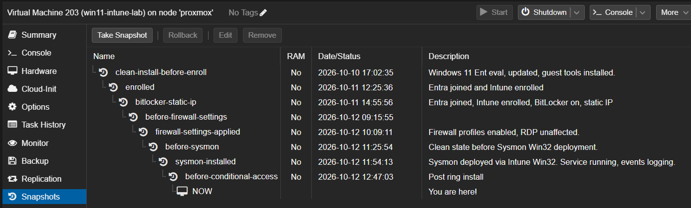
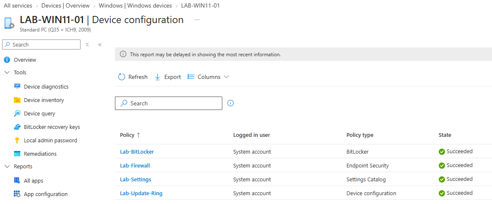
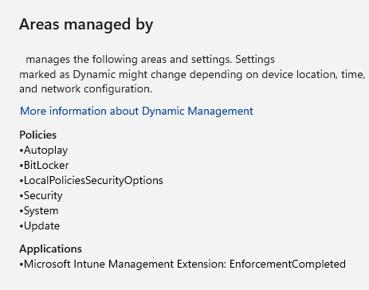
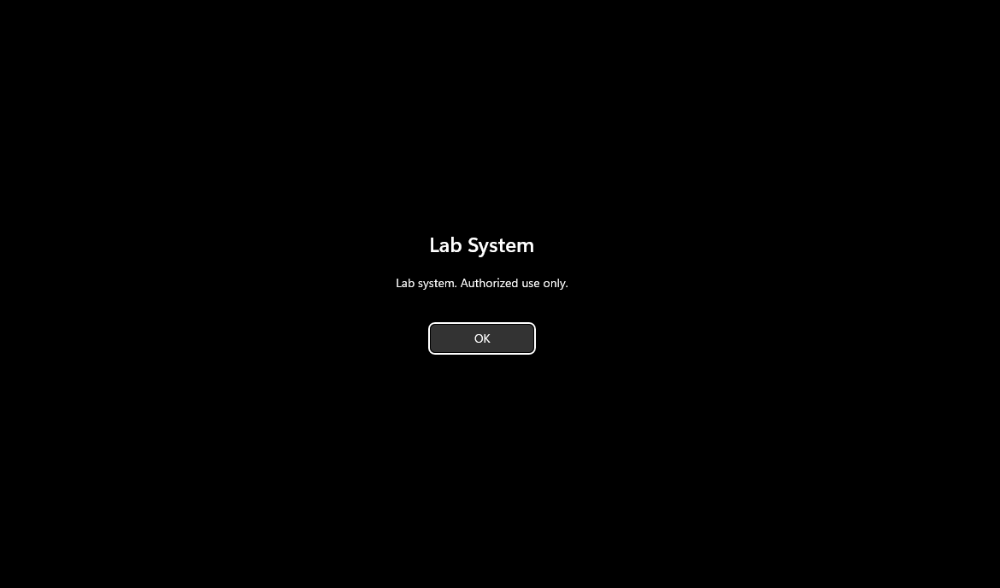
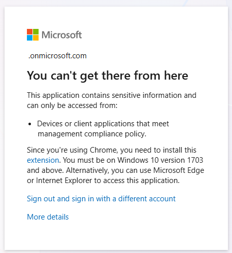
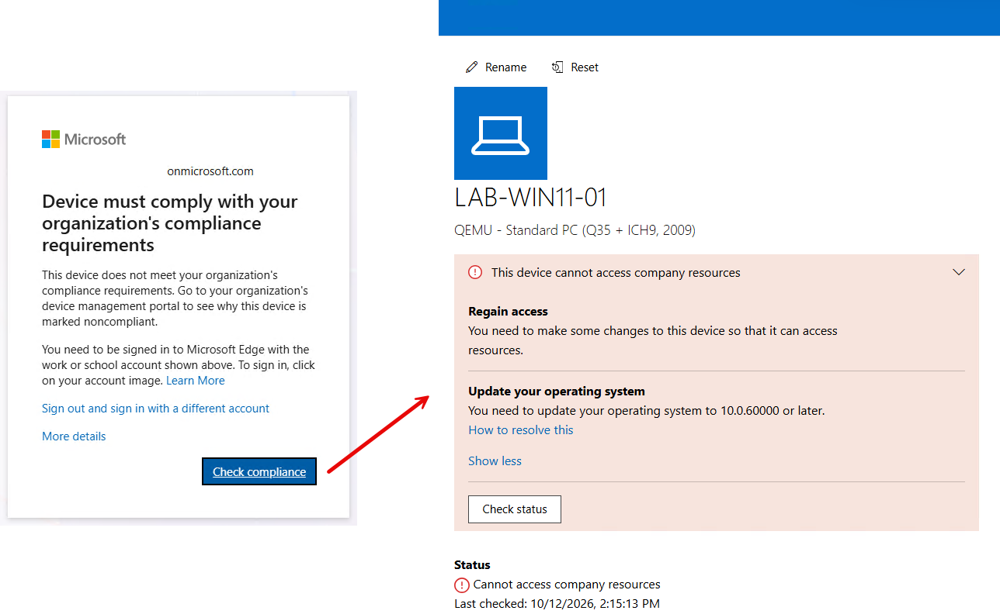

# Building an Intune-managed Windows 11 lab on Proxmox

Written October 11, 2026. This is a work in progress.

I built a Windows 11 VM on my Proxmox home lab, joined it to Microsoft Entra ID, enrolled it in Intune, and got a compliance policy and a BitLocker policy working on it. The most useful thing I learned was that Intune reported the BitLocker policy as Succeeded while the device was failing to apply it.

## Why I built it

My earlier Intune exposure was coursework, not a working lab, and I wanted to show I could run the full path myself: build an endpoint, enroll it, push policy, and troubleshoot when it did not behave. A Windows VM was also a gap in my Proxmox home lab, so this filled both needs.

## The setup

| Component | Detail |
| --- | --- |
| Hypervisor | Proxmox VE 9.2 on my existing home lab |
| Windows VM | Windows 11 Enterprise Evaluation (build 26100), q35 machine, UEFI (OVMF), virtual TPM 2.0, 4 cores, up to 8 GiB RAM, 100 GiB disk, VirtIO SCSI storage |
| Tenant | A new Microsoft tenant made for the lab, with 30-day trials of Intune Plan 1 and Entra ID P1 |
| Identity | One lab user, a separate global admin, a `Lab-Users` security group, MFA through a TOTP authenticator app |
| Access | Remote Desktop from my main PC |
| Protection | A Proxmox snapshot and an encrypted Proxmox Backup Server backup of the VM before enrollment |

I took a snapshot before each risky change, so every part of the lab had a rollback point.

## What I built so far

1. Created the VM and installed Windows 11, loading the VirtIO storage driver during setup.
2. Took a snapshot and a backup before enrolling, so I had a clean rollback point.
3. Set up the tenant, the trials, the users, the `Lab-Users` group and the automatic MDM enrollment scope.
4. Joined the VM to Entra ID, confirmed it with `dsregcmd /status`, and checked that it appeared in Intune as a corporate, Intune-managed device with the lab user as primary user.
5. Created a compliance policy with eight settings: BitLocker, Secure Boot, code integrity, minimum OS version, firewall, antivirus, antispyware and Defender real-time protection.
6. Created a BitLocker policy for silent encryption with TPM-only startup and the recovery key backed up to Entra ID.
7. Gave the VM a static IP and pointed its DNS at the lab's CoreDNS server, following the rest of the lab's conventions.

Result: all eight compliance settings report compliant, `manage-bde -status C:` shows Protection On with TPM and Numerical Password protectors, and the device log confirms the recovery key reached Entra ID.

Later I added a firewall policy, a settings catalog profile, a Sysmon app and a Windows Update ring. Intune reports all four policies as Succeeded on the device.

Intune can say Succeeded while a device fails, as the BitLocker problem below showed, so I also checked on the VM itself: registry values for the policies, `manage-bde -status C:`, and the Sysmon service and event log. The VM's own view of what Intune manages is under Settings, Accounts, Access work or school, Info.

The Lab-Settings policy also sets a logon notice. It appears at sign-in, not when the session is locked.

## What broke and how I fixed it

| Symptom | Cause | Fix |
| --- | --- | --- |
| Remote Desktop failed with error 0x204 | The VM had no Remote Desktop listener until a full reboot. I first suspected the VPN and the host firewall, then ruled them out with a port test from another VM and `qwinsta` on the Windows VM. | Rebooted the VM. The listener appeared and the connection worked. |
| Automatic Intune enrollment was not available | The Intune trial does not include the Entra ID Premium license that automatic MDM enrollment needs. | Started a separate Entra ID P1 trial and assigned the license to the lab users. |
| No compliance result for over an hour, and the dashboard still showed healthy | Dashboard and device pages update more slowly than the policy's own pages. I also changed the assignment from the user group to All devices, so I did not isolate which of the two mattered. | Used the policy's Monitor and Per-setting status pages, which showed the result first. Intune does not let you mix specific groups with All devices in one assignment, so I swapped them. |
| BitLocker policy showed Succeeded in Intune, but `manage-bde` showed Protection Off and no key protectors | The Windows install ISO and the VirtIO ISO were still attached as virtual DVDs. The BitLocker Management event log repeated event 853, "detected bootable media (CD or DVD)". | Set both drives to no media in Proxmox. The policy retried on its own, protection turned on, and event 845 confirmed the key backup to Entra ID. |
| BitLocker compliance passed before my policy applied | Windows had started device encryption on its own (event 4146) but left the key unprotected. Intune only checks that the drive is encrypted. | The BitLocker policy added the TPM and recovery password protectors. |
| `.lab` names did not resolve after setting a static IP and DNS | IPv6 was still enabled, so Windows asked the ISP's IPv6 DNS server instead of the lab's CoreDNS. | Disabled IPv6 on the adapter, as the lab already does on its other machines. |
| The device stayed Noncompliant for over an hour after I restored the minimum OS version, even though the VM reported successful syncs | Seven of the eight settings were Compliant and only the minimum OS version failed, although the device reported a build well above the required one. The policy's Last contacted time was older than my syncs. I could not confirm the cause, but it looked like a stale evaluation. | Forcing syncs did not speed it up. The device flipped to Compliant on its own, and I then confirmed the lab user could sign in again. |

## Conditional Access results

I disabled security defaults, which made Microsoft create its own managed Conditional Access policies, and I excluded my break-glass account from all of them. Then I created a policy for the `Lab-Users` group on Office 365 that requires MFA and a compliant device. I ran it in report-only mode first. In report-only mode a sign-in from an unmanaged PC logged a failure but still let me in, because report-only never blocks. After I switched the policy to On, the same sign-in was blocked.

To prove the policy reacts to device state, I raised the minimum OS version in the compliance policy above what Windows reports. The VM went Noncompliant and the lab user was blocked on the VM. The Check compliance button opens the Company Portal, which tells the user what to fix.

## What I took from it, and what is next

Three lessons stand out. Portal status is not device truth, so when a policy looks fine in Intune but the device disagrees, the device's own event log decides. A compliant device is not always a protected one, because a compliance check tests a narrow condition. And first policies take time to arrive, so I check the policy's own status pages before changing anything.

Still to do in this lab:

- Remote actions, a wipe and rebuild, and cleanup before the 30-day trials end

I will add more screenshots (the enrolled device, the compliance results, the BitLocker event log, and the recovery key location with the key hidden) as I finish each part.

The firewall policy, the settings catalog profile (inactivity limit, Autoplay off, logon banner), the Sysmon app deployed through Intune, the Windows Update ring and the Conditional Access tests are done and are written up in the tutorial.
